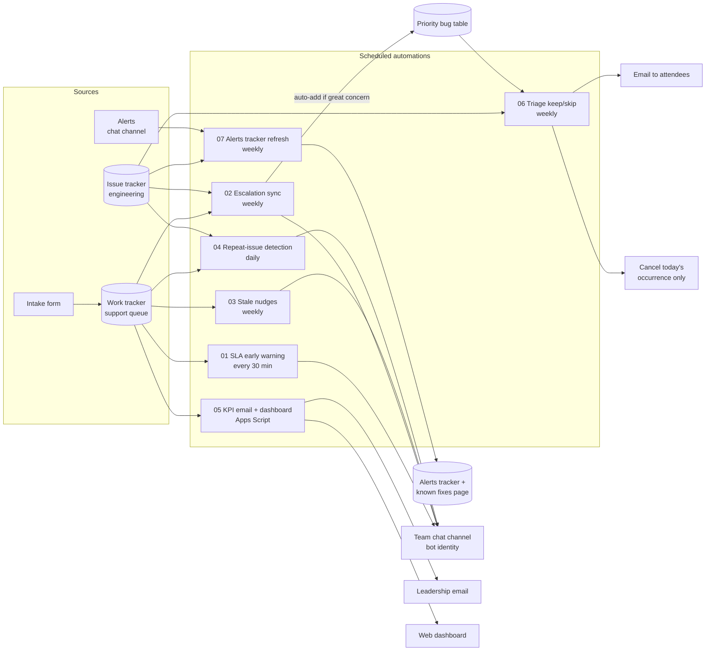

# Ops Automation Portfolio

Workflow automations I designed and built for a **digital advertising
company's technical operations team**. That team is the escalation point
between client-facing staff and engineering for campaign delivery, reporting,
tracking, creative and platform issues.

> **Disclaimer.** This is a sanitized, from-scratch recreation built for
> portfolio purposes. It has **no proprietary code, data, configuration,
> documentation, or names** from any employer, client or partner. All IDs,
> people, companies, tickets and numbers are fictional placeholders, and the
> logic is reimplemented generically to show the patterns and engineering.

## Impact (what these workflows changed)

- **SLA misses are caught before they happen.** Early warnings replaced
  after-the-fact KPI reports.
- **Bugs reach engineering faster.** A weekly sync links support requests to
  engineering issues and escalates the serious ones automatically, with strict
  rules.
- **Fewer meetings.** The weekly triage meeting is skipped automatically when
  there's nothing to decide, and only that day's occurrence is cancelled.
- **Repeat issues are spotted early.** Clustering turns five separate requests
  into one incident alert.
- **Leadership visibility without a BI tool.** A Google Apps Script KPI email
  and web dashboard.
- **Better intake.** A form designed so the first reply can be an answer, not
  a question.

## Tech

Google Apps Script (UrlFetchApp, MailApp, HtmlService, CacheService, triggers) ·
JavaScript / Node.js · REST APIs (Asana-style work tracker, Jira-style issue
tracker) · Slack (webhooks, mentions) · Outlook-style email and calendar ·
scheduled **AI-agent routines** with guardrails.

## Architecture



## Workflows

| # | Folder | What it shows |
|---|---|---|
| 01 | [`01-sla-early-warning`](01-sla-early-warning) | Business-minute SLA math, pre-breach warnings, dedupe, safe @-mentions |
| 02 | [`02-escalation-sync`](02-escalation-sync) | Grouping requests, matching to issues, a strict auto-escalation rule |
| 03 | [`03-stale-request-nudge`](03-stale-request-nudge) | Idle / unassigned / past-due detection, "waiting on" inference |
| 04 | [`04-repeat-issue-detection`](04-repeat-issue-detection) | Text similarity + union-find clustering, draft incident alert |
| 05 | [`05-kpi-dashboard-apps-script`](05-kpi-dashboard-apps-script) | Apps Script KPI engine, HTML email, idempotent triggers, web dashboard |
| 06 | [`06-triage-meeting-email`](06-triage-meeting-email) | Keep/skip logic, 30-day lifecycle, single-occurrence cancel, fail closed |
| 07 | [`07-alerts-tracker-refresh`](07-alerts-tracker-refresh) | Chat → tracker upsert, evidence-based resolution, keeps manual fields |
| 08 | [`08-intake-form-design`](08-intake-form-design) | Intake schema tied to routing and KPIs |
| — | [`agent-routines`](agent-routines) | Guardrail patterns for running AI agents unattended |
| — | [`shared`](shared) | Business-time math, seen-store, REST clients, delivery helpers |

## Run it

No dependencies and no network access needed. Everything runs on fictional
sample data, in dry-run mode.

```bash
npm test        # 12 unit tests, including the Apps Script KPI math in a Node VM
npm run demo    # prints each workflow's output
```

## License

[MIT](LICENSE)
